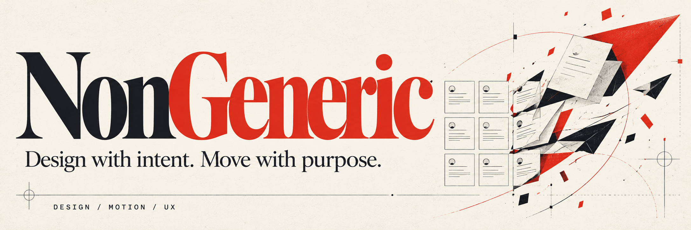

# NonGeneric (`nongeneric`)

**The Anti-Generic AI Art Director, UI/UX Architect & GreenSock (GSAP) Motion Choreographer.**

Build interfaces around real user tasks, deliberate visual direction, and purposeful motion. NonGeneric combines agent instructions with a local CLI for design seeds, tokens, animation blueprints, and static checks.

[MIT license](LICENSE) · [Contributing](CONTRIBUTING.md) · [Changelog](CHANGELOG.md) · [Security](SECURITY.md) · [Code of conduct](CODE_OF_CONDUCT.md)

`nongeneric` is a multi-harness AI agent plugin (Claude Code, OpenAI Codex, Cursor, Universal Agents, GitHub Copilot) and zero-dependency TypeScript CLI engine reverse-engineered via [`morluto/rea`](https://github.com/morluto/rea) from [`pbakaus/impeccable`](https://github.com/pbakaus/impeccable) and [`greensock/gsap-skills`](https://github.com/greensock/gsap-skills), fused with [`Kyaa-A/StockFish`](https://github.com/Kyaa-A/StockFish) (`KnightVision`) editorial-interactive craft and [`Kyaa-A/doesntbreak`](https://github.com/Kyaa-A/doesntbreak) 320px–1440px responsive discipline.

---

## Why `nongeneric` Exists

Left unguided, LLMs converge on the statistical average of their training corpus:
- **Visual Slop**: `Inter` or `Roboto`, purple-to-indigo gradients (`#8b5cf6` → `#6366f1`), `background-clip: text` rainbow headings, diffuse neon `box-shadow` glows, `border-l-4` side stripes on rounded cards, and 3-column icon-in-colored-circle grids.
- **Copy Slop**: Sparkle emojis (`✨`), "Unleash the power of next-generation seamless workflows", em-dash overuse (`—`), and "Not a X. A Y." aphoristic tics.
- **Motion Slop & Jank**: `animate-bounce`, `transition: all`, GSAP tweens animating layout-thrashing `width`/`height`/`top`/`left`, nested `ScrollTrigger`s inside timelines, `containerAnimation` without `ease: "none"`, React `useEffect` memory leaks without `useGSAP()`, and missing `prefers-reduced-motion` support.
- **Responsive Breakage**: `100vw` horizontal scrollbars, bare `100vh` mobile jumps, missing `min-width: 0` on flex/grid children, and `<16px` inputs triggering iOS Safari zoom.

`nongeneric` replaces template slop with **committed Aesthetic Worlds**, **4 Visitor Modes**, **60fps GSAP Choreography**, and a **deterministic 82-rule static detector & source auditor**.

| Verification Fixture | Static Audit Result | What It Demonstrates |
| :--- | :--- | :--- |
| [`examples/broken-ai-slop.html`](examples/broken-ai-slop.html) | **Grade F** (`23` primary findings) | Purple/indigo gradients, `Inter`, sparkle copy, `100vw` overflow, layout-thrashing GSAP tweens, and missing reduced-motion handling |
| [`examples/crafted-knightvision.html`](examples/crafted-knightvision.html) | **100/100 Grade S** (`0` findings) | Committed `knightvision-editorial-telemetry` world, OKLCH tokens, tri-voice typography, cleanup-safe GSAP choreography, and a working interactive proof |

---

## Quickstart

### Requirements

- Node.js 20 or newer.
- npm for development setup or local CLI installation.
- A compatible agent host to use the skills; the CLI also works independently.

The CLI has no runtime npm dependencies. Generated animation code requires GSAP and, for React examples, `@gsap/react` in the application where you use it.

### 1. Run the CLI Instantly or Install the Skill Pack
```bash
# Run a static audit on any project without cloning (Node 20+)
npx --yes github:Kyaa-A/nongeneric audit ./src

# Claude Code plugin install
/plugin marketplace add Kyaa-A/nongeneric
/plugin install nongeneric@nongeneric

# Local checkout for Universal / Codex / Cursor / Antigravity
git clone https://github.com/Kyaa-A/nongeneric.git
cd nongeneric
npm ci
npm run build
node scripts/nongeneric.js doctor
```

Cloning makes the source available; it does not automatically activate skills in your agent host. The canonical entry point is [skills/nongeneric/SKILL.md](skills/nongeneric/SKILL.md), with host manifests in `.claude-plugin/`, `.codex-plugin/`, and `.cursor-plugin/`. Configure your host to load the skill/plugin using its installation mechanism.

The relative commands below run from this repository root. From a different application directory, use the absolute path to this checkout's `scripts/nongeneric.js`, or run `npm link` in this checkout and use `nongeneric`:

```bash
# After npm link, run from the application you want to inspect:
nongeneric audit ./src
```

Example agent request: “Use NonGeneric to improve this booking flow. Preserve the brand, cover loading/error/recovery states, and verify the result in the browser.”

### 2. CLI Commands (`node scripts/nongeneric.js`)

```bash
# 1. Roll an offline-first Concept Seed, Challenger Worlds & Structural Compositions
node scripts/nongeneric.js seed --scope direction --mode persuade --grain product

# 2. Export OKLCH Design Tokens & Fluid Clamp Typography Scale (css | json | tailwind)
node scripts/nongeneric.js tokens --world knightvision-editorial-telemetry --format css

# 3. Generate Cleanup-Safe, Reduced-Motion-Safe GSAP Choreography Blueprints
node scripts/nongeneric.js motion-plan --pattern hero-reveal --framework react --world knightvision-editorial-telemetry

# 4. Scan Files or Directories with the 82-Rule Anti-Slop, Motion & Responsive Detector
node scripts/nongeneric.js detect src/ examples/crafted-knightvision.html

# 5. Run a 0-100 Static-Check Audit with Prioritized P0-P3 Remediation Plan
node scripts/nongeneric.js audit examples/crafted-knightvision.html

# 6. Inspect All 82 Rules or Curated Aesthetic Worlds
node scripts/nongeneric.js rules
node scripts/nongeneric.js worlds
```

---

## UX and Verification Workflow

Start with the [Interaction Pattern Library](skills/nongeneric/references/interaction-patterns.md) when deciding between a modal, side panel, sidebar, popover, menu, tooltip, inline disclosure, toast, banner, or full page. It includes selection trade-offs, keyboard/focus and mobile behavior, acceptance checks, and links to live examples from open-source design systems.

Before styling, define the primary task, user flow, information hierarchy, and applicable loading, empty, success, error, and recovery states using the [UX workflow](skills/nongeneric/references/ux-workflow.md).

Before claiming a surface is verified, follow the [browser verification protocol](skills/nongeneric/references/browser-verification.md): inspect rendered layouts, complete the task and a recovery path, and check keyboard access, reduced motion, and runtime behavior. Report tested scope and unavailable evidence explicitly.

The CLI audit score measures recognized source patterns only. Even an empty-body HTML page can score 100 when no patterns are detected; that is not a design-quality certificate. JSON exposes `scoreKind: "static-checks"` and separate `verification` fields marked `not-verified`. With no supported files, audit returns null score/grade and exit code 1. Browser evidence belongs in a separate review report.

## The 4 Visitor Modes

| Visitor Mode | Primary Intent | How the Aesthetic World Enters | First Viewport Mandate |
| :--- | :--- | :--- | :--- |
| **`persuade`** | Evaluate offer, feel desire, convert | World owns ground, surfaces, and display type; conversion lives inside the form | Must feature a **live working interactive proof** (e.g., `KnightVision` live evaluation board), never a static stock graphic |
| **`operate`** | Execute tasks, inspect telemetry, act | World lends **only 4 things**: `type`, `palette`, `density`, and **one signature move** | Real working shell, standard platform controls, semantic status colors |
| **`read`** | Understand docs, specs, or essays | World owns the **frame** (masthead, rail, openers, marginalia); prose column stays calm | `60ch–75ch` reading measure, `>=16px` body, `>=7:1` contrast |
| **`experience`** | Immerse in interactive/spatial work | The interactive or narrative work leads from the first pixel | One dominant choreographed move per viewport region |

---

## Curated Aesthetic Worlds (Offline-First Catalog)

| World ID | Well Tier | Lineage & Signature | Primary GSAP Recipe |
| :--- | :--- | :--- | :--- |
| `knightvision-editorial-telemetry` | `graphic` | *New In Chess* print monographs + Stockfish 19 NNUE live candidate bars + Q/E keycaps | `SplitText` masked rise + `Flip` candidate reorder + `quickTo` eval gauge |
| `swiss-railway-chronograph` | `graphic` | Josef Müller-Brockmann exposed 1px hairline grids + SBB vermilion indicator | Hairline `scaleX`/`scaleY` draw (`expo.out`) + `ScrollTrigger.batch()` |
| `archival-monograph-press` | `graphic` | Aldine press + Tufte synchronized marginalia rail + cinnabar rubrics | `ScrollTrigger` active paragraph-to-marginalia sync |
| `bathymetric-nautical-atlas` | `graphic` | NOAA hydrographic depth contours + coordinate graticule frame | `DrawSVGPlugin` contour reveal + scrubbed depth gauge |
| `field-operator-teenage-eng` | `interaction` | Teenage Engineering OP-1 Field anodized bays + recessed OLED + color encoders | `Draggable` + `quickTo()` parameter curves |
| `orderbook-tape-terminal` | `interaction` | Institutional depth ladders + inline volume histograms + tabular numerals | 60fps `scaleX` histogram bars via `quickTo()` |
| `kinetic-broadcast-chyron` | `interaction` | Live broadcast lower-thirds + geometric plate wipes + SMPTE timecode bug | Interlocking `scaleX` plate wipes + `SplitText` chars |
| `neo-kinpaku-gold-lacquer` | `atmosphere` | Kyoto urushi matte charcoal + kinpaku gold-leaf seams + vermilion hanko seal | Ceremonial `power3.out` byobu panel unfold |
| `botanical-herbarium-folio` | `atmosphere` | Kew Gardens mounted herbarium sheets + ruled binomial determination slip | `Flip.from(state)` catalog-to-specimen sheet morph |

---

## 16 Slash Commands

| Command | Purpose |
| :--- | :--- |
| `/nongeneric:init` | Interview for durable product truth and write `PRODUCT.md` |
| `/nongeneric:shape` | Classify Visitor Mode, roll Concept Seed, and confirm a surface brief |
| `/nongeneric:craft` | Build a complete anti-generic surface with OKLCH tokens, working proof, and GSAP motion |
| `/nongeneric:animate` | Choreograph cleanup-safe, reduced-motion-safe 60fps GSAP animations |
| `/nongeneric:overdrive` | Push a surface with a signature pinned stage, FLIP morph, or kinetic type |
| `/nongeneric:critique` | Run an unanchored Dual-Persona Critique (`Design Director` + `Target Visitor`) |
| `/nongeneric:audit` | Execute the 82-rule detector and 0–100 Static-Check Scorecard with P0–P3 plan |
| `/nongeneric:polish` | Final alignment, contrast, focus-ring, and optical spacing pass |
| `/nongeneric:typeset` | Upgrade to Tri-Voice typography, fluid `clamp()`, and `tabular-nums` |
| `/nongeneric:colorize` | Apply cohesive OKLCH tokens and eliminate AI gradients / gray-on-color |
| `/nongeneric:layout` | Replace monotonous 3-card grids with asymmetric compositions |
| `/nongeneric:bolder` | Re-roll in the `bolder` register and deepen world commitment |
| `/nongeneric:quieter` | Strip competing glows/badges and restore Ma negative space |
| `/nongeneric:distill` | Flatten nested cards and remove marketing buzzwords |
| `/nongeneric:harden` | Enforce 320px–1440px responsive invariants, 44px tap targets, and WCAG AA+ |
| `/nongeneric:document` | Extract the incumbent design & motion system into `DESIGN.md` |

---

## Documentation, Expansion Packs & Reverse-Engineering Ledger

### Core Documentation
- [REA Reverse-Engineering Evidence Ledger](docs/rea-reverse-engineering-ledger.md)
- [NonGeneric System Architecture](docs/architecture.md)
- [Main Skill Playbook](skills/nongeneric/SKILL.md)
- [GSAP Mastery Manual](skills/nongeneric/references/gsap-mastery.md)
- [82-Rule Anti-Slop Catalog](skills/nongeneric/references/anti-slop-catalog.md)

### Expansion World Packs (`packs/worlds/` & `packs/index.mjs`)
- [`broadcast-kinetic`](packs/worlds/broadcast-kinetic.mjs) — High-velocity motorsport/esports broadcast telemetry ([Showcase](examples/showcases/broadcast-kinetic.html))
- [`monastic-washi`](packs/worlds/monastic-washi.mjs) — Monastic Washi & Sumi Ink editorial monograph ([Showcase](examples/showcases/monastic-washi.html))
- [`avionics-cnc`](packs/worlds/avionics-cnc.mjs) — Anodized CNC & flight-deck avionics console ([Showcase](examples/showcases/avionics-cnc.html))
- [`bauhaus-constructivist`](packs/worlds/bauhaus-constructivist.mjs) — Bauhaus Dessau & constructivist exhibition archive ([Showcase](examples/showcases/bauhaus-constructivist.html))
- [`botanical-herbarium`](packs/worlds/botanical-herbarium.mjs) — Archival botanical herbarium & natural history ([Showcase](examples/showcases/botanical-herbarium.html))
- [`fintech-ledger`](packs/worlds/fintech-ledger.mjs) — Institutional ledger & high-density financial telemetry
- [`artifact-workbench`](packs/worlds/artifact-workbench.mjs) — Spatial AI artifact workbench & provenance canvas
- [`atelier-lookbook`](packs/worlds/atelier-lookbook.mjs) — Independent luxury atelier & tactile lookbook

### GSAP Motion Choreography Suites (`packs/motion/` & `docs/playbooks/`)
- [`svg-choreography`](packs/motion/svg-choreography.mjs) — `DrawSVG`, `MorphSVG`, and orbital `MotionPath` ([Playbook](docs/playbooks/svg-choreography.md))
- [`gesture-physics`](packs/motion/gesture-physics.mjs) — `Observer`, `Draggable`, and WCAG keyboard parity ([Playbook](docs/playbooks/gesture-physics.md))
- [`velocity-marquee`](packs/motion/velocity-marquee.mjs) — Seamless `xPercent` loops & clamped scroll-velocity skew ([Playbook](docs/playbooks/velocity-marquee.md))
- [`shader-stage-bridge`](packs/motion/shader-stage-bridge.mjs) — GSAP-to-WebGL/Three.js uniform proxy bridge ([Playbook](docs/playbooks/domain-webgl-stages.md))
- [`text-scramble-telemetry`](packs/motion/text-scramble-telemetry.mjs) — Screen-reader-safe cipher glyph decode & odometer rolls ([Playbook](docs/playbooks/text-scramble-telemetry.md))
- [`flip-shared-element`](packs/motion/flip-shared-element.mjs) — Shared-element `Flip` card-to-dossier & lightbox transitions ([Playbook](docs/playbooks/flip-shared-element.md))

### Domain Anti-Slop Playbooks (`docs/playbooks/`)
- [Fintech, Trading & Telemetry Consoles](docs/playbooks/domain-fintech-telemetry.md)
- [AI-Native Workspaces (Anti-Chat-Bubble Slop)](docs/playbooks/domain-ai-native-workspaces.md)
- [Luxury & Independent Editorial Commerce](docs/playbooks/domain-luxury-commerce.md)
- [Creative Coding, WebGL & Shader Stages](docs/playbooks/domain-webgl-stages.md)

## Development and Support

Read [CONTRIBUTING.md](CONTRIBUTING.md) for setup, source/generated-file conventions, and pull request expectations. Required checks:

```bash
npm run build
npm run typecheck
npm run check:generated
npm run check:json
npm test
```

Use [GitHub Issues](https://github.com/Kyaa-A/nongeneric/issues) for bugs, usage questions, and feature requests. Include the command or prompt, version/commit, and a small reproduction. Report vulnerabilities through [SECURITY.md](SECURITY.md).

### Troubleshooting

- **Cannot find `scripts/nongeneric.js`:** run from this checkout, use an absolute script path, or use the linked CLI.
- **Generated files are out of date:** run `npm run build` and include the generated changes.
- **Audit says NOT SCORED:** check that the target exists and contains supported source files.
- **High static score but a broken interface:** run the browser verification protocol; static checks do not execute the interface.

## License and Acknowledgments

This repository is licensed under the [MIT License](LICENSE), copyright © 2026 [Asnari Pacalna (Kyaa-A)](https://github.com/Kyaa-A).

The project draws on the projects credited above; see the [evidence ledger](docs/rea-reverse-engineering-ledger.md) for provenance. External libraries, fonts, assets, and referenced projects retain their respective licenses. The repository's MIT license does not relicense those materials.
