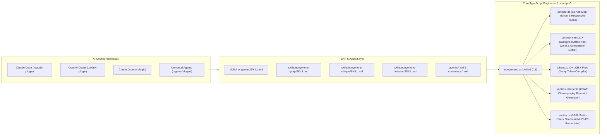

# NonGeneric Architecture Guide

`nongeneric` is structured as both a **Multi-Harness AI Agent/Skill Plugin** and a **Zero-Dependency TypeScript CLI & Static Analysis Engine**.

## System Diagram

## Module Responsibilities

| Module | Source File | Compiled Output | Responsibility |
| :--- | :--- | :--- | :--- |
| **Types** | `src/types.ts` | `scripts/types.js` | Shared TypeScript interfaces for rules, findings, worlds, compositions, tokens, motion blueprints, and audit reports. |
| **Rules Registry** | `src/rules-registry.ts` | `scripts/rules-registry.js` | Canonical registry of 82 deterministic rules across `slop`, `quality`, `motion`, `responsive`, `copy`, and `security`. |
| **Detector** | `src/detector.ts` | `scripts/detector.js` | Multi-pass static scanner for HTML, CSS, SCSS, JSX, TSX, Vue, and Svelte with inline-ignore support (`nongeneric-disable` / `impeccable-disable`). |
| **World Catalog** | `src/catalog.ts` | `scripts/catalog.js` | Curated offline catalog of 18 Aesthetic Worlds and 12 Structural Compositions with OKLCH tokens and GSAP recipes. |
| **Concept Seed** | `src/concept-seed.ts` | `scripts/concept-seed.js` | Deterministic SHA-256 seed roller dealing assigned directions, challenger worlds, structural compositions, and visitor mode laws. |
| **Token Compiler** | `src/tokens.ts` | `scripts/tokens.js` | Generates CSS custom properties (`oklch()`), JSON design tokens, and Tailwind v4 `@theme` blocks for any world. |
| **Motion Planner** | `src/motion-planner.ts` | `scripts/motion-planner.js` | Emits cleanup-safe (`useGSAP` / `gsap.context`), `gsap.matchMedia()` reduced-motion-safe GSAP choreography blueprints. |
| **Static Auditor** | `src/auditor.ts` | `scripts/auditor.js` | Computes a 0–100 source-pattern score across 5 pillars; reports visual quality, usability, accessibility, and runtime behavior as unverified and ranks remediation steps P0–P3. |
| **CLI Entrypoint** | `src/nongeneric.ts` | `scripts/nongeneric.js` | Command-line interface exposing `detect`, `seed`, `tokens`, `motion-plan`, `audit`, `rules`, `worlds`, and `doctor`. |
